<div align="center">

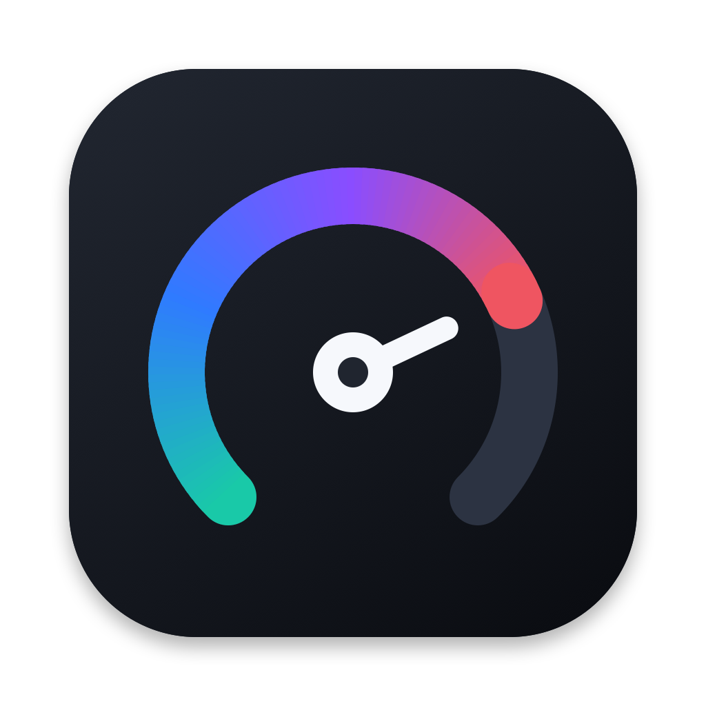

# NotchDeck

**A control panel that drops down from your Mac's menu bar.**

English · [简体中文](README.zh-CN.md)

</div>

Click the menu bar icon or press **⌥⌘N** and a panel opens with your todos, schedule, system stats, clipboard,
timers, music and quick toggles. It is written in Swift and SwiftUI, has no Dock icon, needs no account and keeps
your data on your Mac.

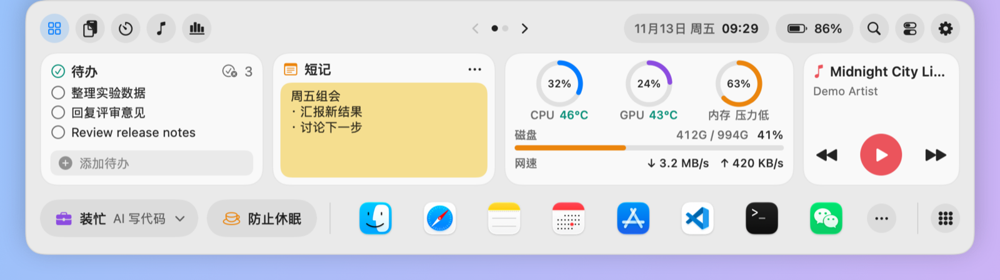

## Screenshots

| Second home page | Quick controls |
| --- | --- |
| 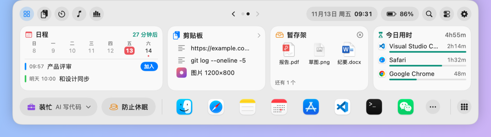 | 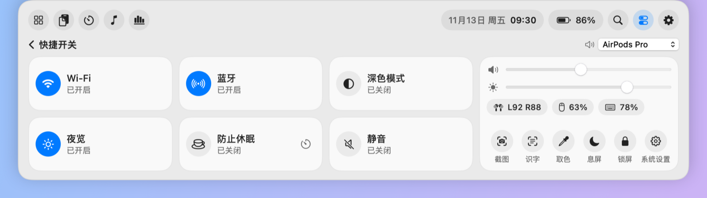 |
| **System monitor** | **Clipboard history** |
| 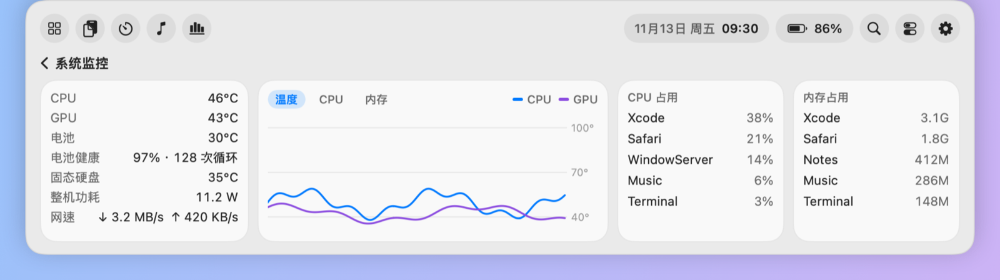 | 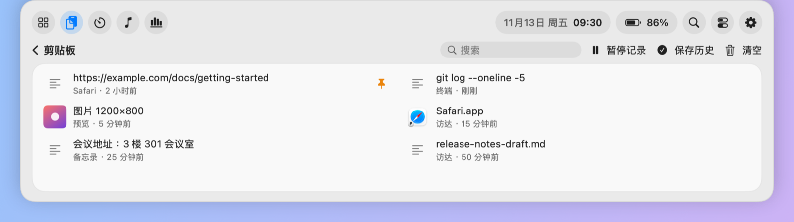 |
| **Search** | **Music** |
| 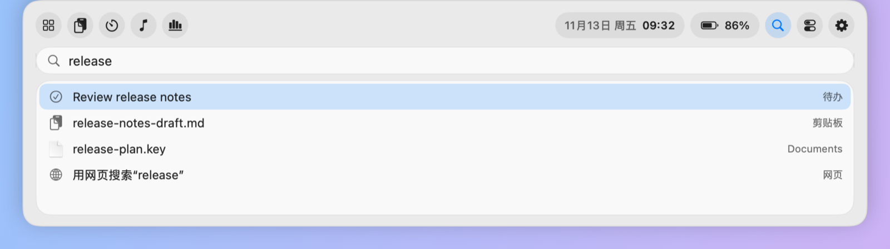 | 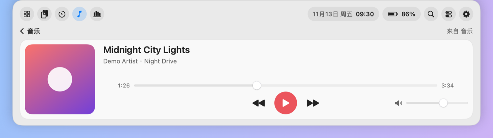 |
| **Timers** | **AI token usage** |
| 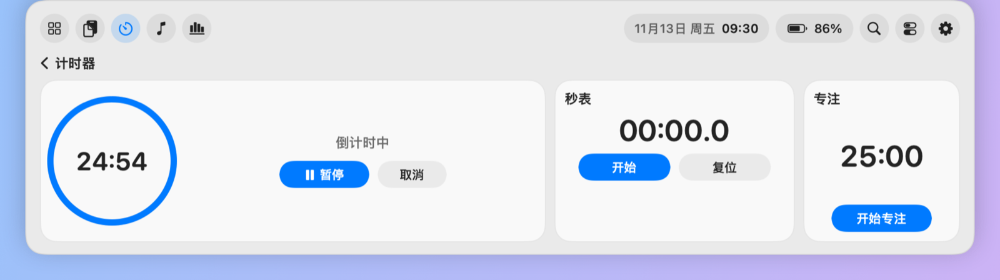 | 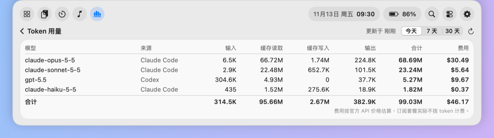 |

**Clipboard smart cleanups**: right-click an item and NotchDeck suggests only the cleanups that fit it.

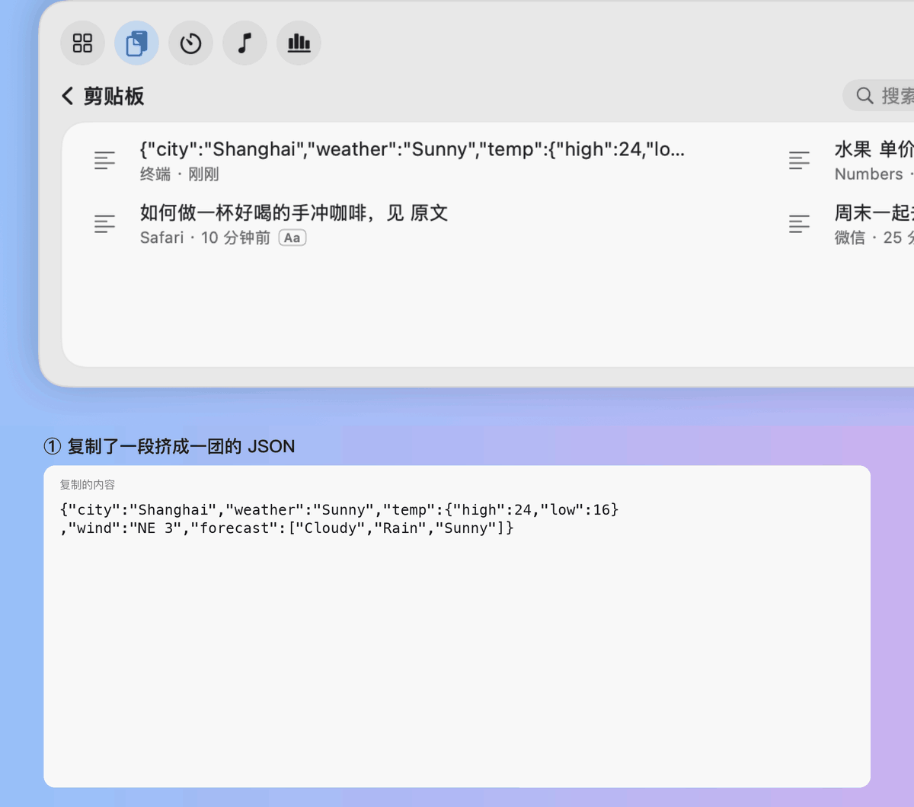

**Look Busy**: switch to a convincing full-screen work scene in one keystroke.

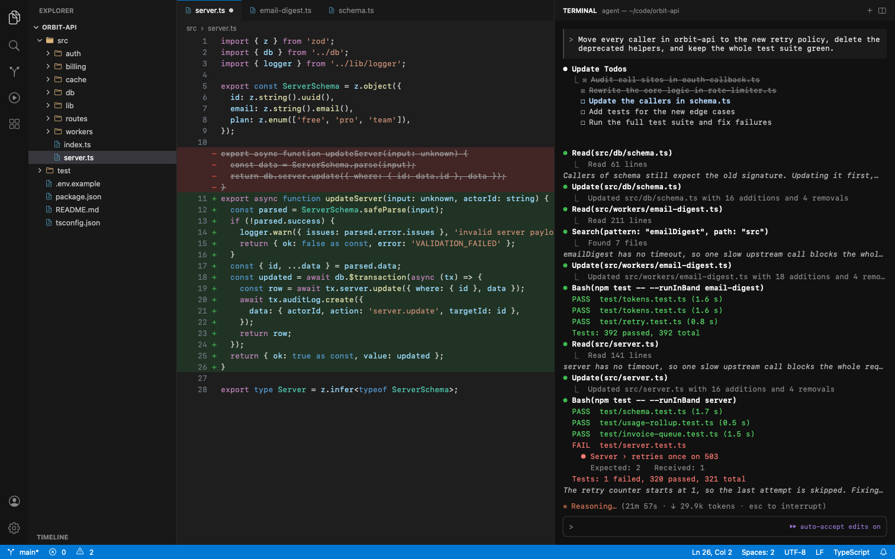

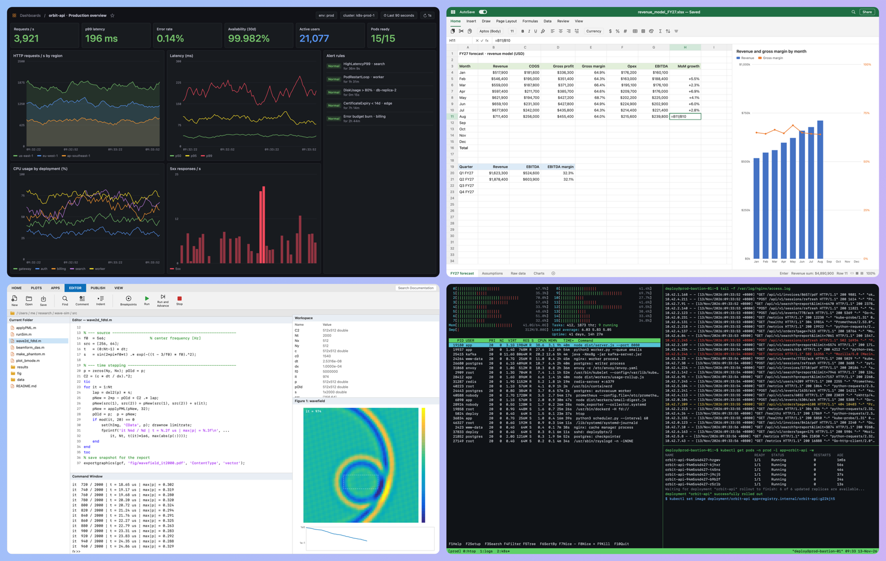

The screenshots use made-up demo data and the Chinese interface.

## Features

**Home**
- **Cards**: todos, sticky note, system monitor, music, schedule, clipboard, shelf and today's time, plus optional clock, month calendar, timer, token usage and Look Busy cards. Reorder, hide or spread them over two pages.
- **Schedule**: this week's dates and the events of the next 7 days, with a join button for Zoom, Teams, Google Meet, Tencent Meeting, Feishu and other meeting links.
- **Shelf**: drop files on the panel to keep them for later, then drag them out or open them.
- **Today's time**: how long each app has been in front today.

**Menu bar**
- The top bar shows the date and time; next to the icon you can show temperature, CPU, network speed, battery and an update arrow.
- Right-click the icon for search, clipboard, the monitor, audio output, a quick countdown, keep awake, Look Busy, display sleep, screen lock and update checks.

**Clipboard**
- Text, images and files, with search and pinning, kept across restarts. Items marked sensitive by password managers are skipped.
- Keeps bold, links and tables; a click copies the original, plain text, or clean formatting without fonts and colors.
- Right-click for smart cleanups: format JSON, turn a table into Markdown, LaTeX or CSV, strip tracking parameters, join lines broken by PDFs and more.
- Recognize the text in an image, or cut out its subject, on your Mac.

**Tools**
- **System monitor**: temperatures, power draw, memory, disk, network speed, battery health, top processes and 10-minute charts.
- **Quick controls**: Wi-Fi, Bluetooth, dark mode, Night Shift, keep awake, mute, volume, brightness and Bluetooth device batteries.
- **Capture text** and **color picker**: select text on screen to copy it, or pick a HEX color with the magnifier.
- **Timers**: countdown, stopwatch and a 25-minute focus timer.
- **Search**: apps, files, todos, notes and clipboard history.
- **AI token usage** (optional): token counts and estimated cost per model for Claude Code and Codex, read from usage fields only, never your conversations.
- **Reminders sync** (optional): use a list from Reminders as your todo card.

**Look Busy**: ten full-screen work scenes, including AI coding, model training, paper writing, a monitoring dashboard, build and test and a MATLAB simulation. Nothing they show is real. With several displays each one can show its own scene, and portrait displays get a stacked layout.

**Other**: light or dark appearance; Simplified and Traditional Chinese, English, Japanese, Korean, French, German and Spanish; automatic updates that install while you are not using NotchDeck and can be turned off.

## Keyboard shortcuts

| Shortcut | Action |
| --- | --- |
| ⌥⌘N | Open or close the panel |
| ⌃⌥V | Open or close the clipboard page |
| ⌃⌥B | Start or stop Look Busy |
| ⌃⌥T | Select text on screen and copy it |
| ⌃⌥C | Pick a color and copy its HEX value |
| Esc | Close the panel or leave Look Busy |

## Install

Download the latest `.dmg` from [Releases](https://github.com/wangwenxuan61/NotchDeck/releases) and drag NotchDeck to Applications. It needs macOS 14 or later on an Apple silicon Mac.

NotchDeck is not notarized by Apple, so macOS blocks the first launch: open it once and dismiss the warning, then go to **System Settings → Privacy & Security** and click **Open Anyway** next to NotchDeck. Later versions update themselves.

## Permissions

NotchDeck only asks when you turn on a feature that needs it:

- **Calendar**: the schedule card. Events are only read.
- **Reminders**: Reminders sync. Turning it on moves your unfinished local todos into the chosen list.
- **Bluetooth**: the Bluetooth toggle and device batteries.
- **Notifications**: countdown and focus alerts, asked the first time you start a timer.
- **Screen Recording**: capture text, asked the first time you use it. The screenshot is read on your Mac and deleted right away.

From 0.1.11 on, permissions are kept across updates.

## Limitations

- Temperatures, now-playing data, dark mode, Night Shift, brightness, Bluetooth power and screen lock rely on private macOS interfaces. They can stop working after a system update, and the app cannot ship on the Mac App Store.
- The brightness slider only controls the built-in display.
- So far it has only been tested on one Apple silicon Mac with macOS 27 and a single display.

## Development

You only need the Xcode Command Line Tools (`xcode-select --install`):

```bash
git clone https://github.com/wangwenxuan61/NotchDeck.git
cd NotchDeck
./build.sh
open build/NotchDeck.app
```

Before committing, run `swift run NotchDeckChecks` and `python3 scripts/check-translations.py`. GitHub runs both on every push.

Releases are signed with a fixed self-signed certificate, and automatic updates only install versions signed with it. When you build it yourself without that certificate in your keychain, the app is ad-hoc signed and macOS may ask for permissions again after each rebuild.

Do Not Disturb has no public API. To link it with the focus timer, create two Shortcuts named `NotchDeck 专注开始` and `NotchDeck 专注结束`; NotchDeck runs them when a focus session starts and ends.

## License

[MIT](LICENSE)
