<div align="center">

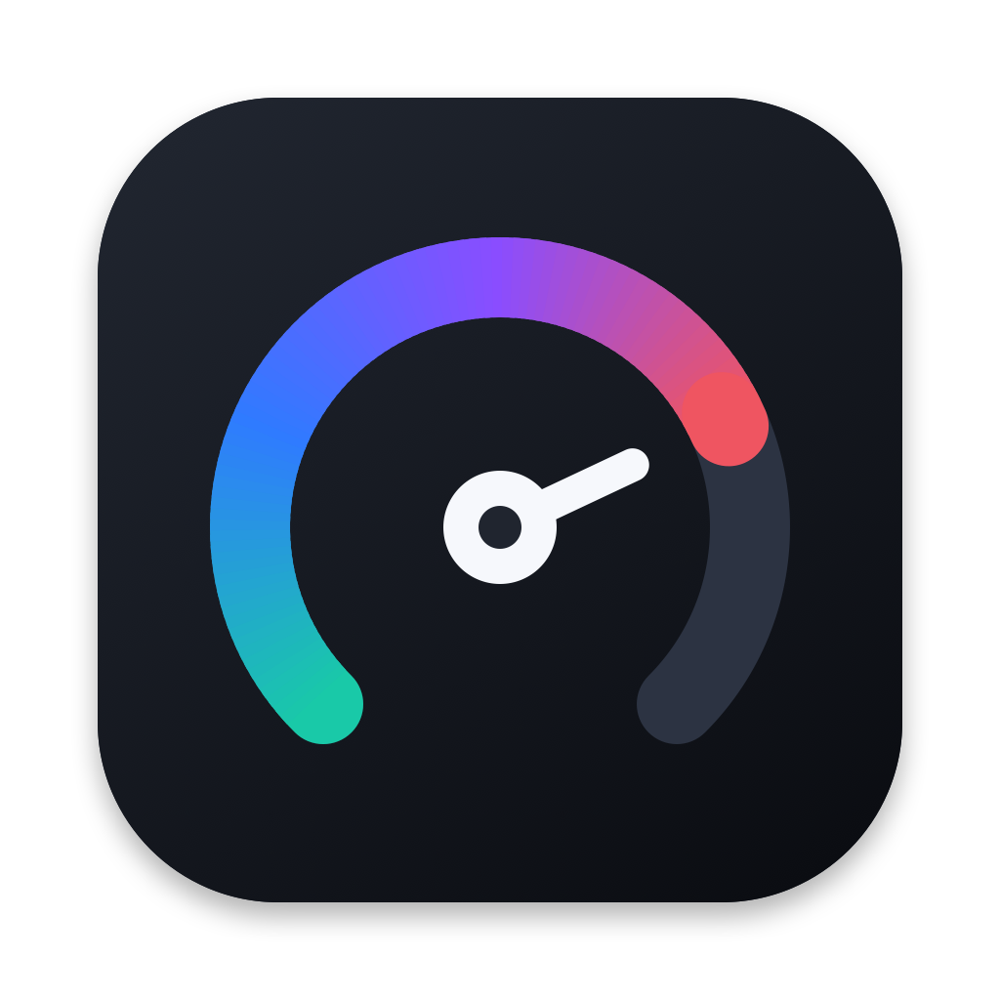

# NotchDeck

**从 Mac 菜单栏弹出的控制面板。**

[English](README.md) · 简体中文

</div>

点菜单栏图标或按 **⌥⌘N**，弹出一个面板：待办、日程、系统状态、剪贴板、计时器、音乐和常用开关都在里面。
用 Swift 和 SwiftUI 写成，不占程序坞，不用注册账号，数据只存在本机。

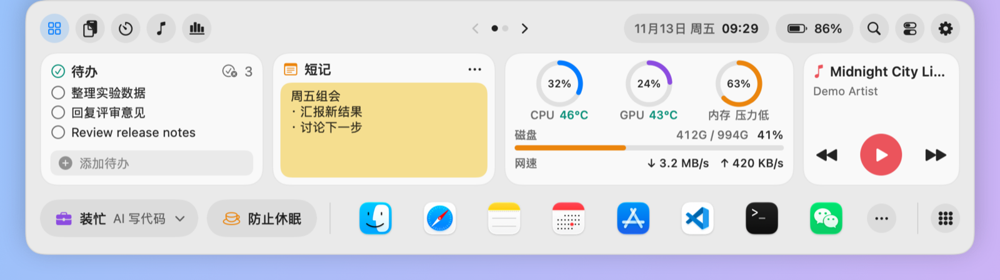

## 截图

| 首页第 2 页 | 快捷开关 |
| --- | --- |
| 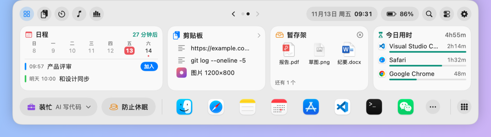 | 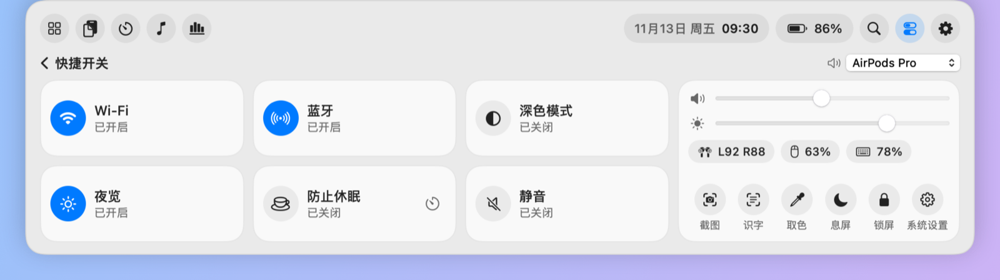 |
| **系统监控** | **剪贴板历史** |
| 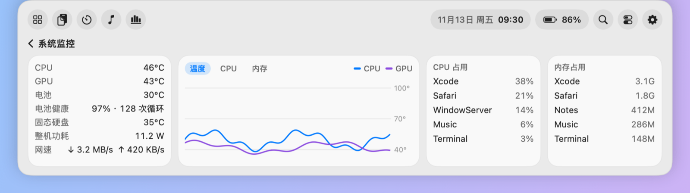 | 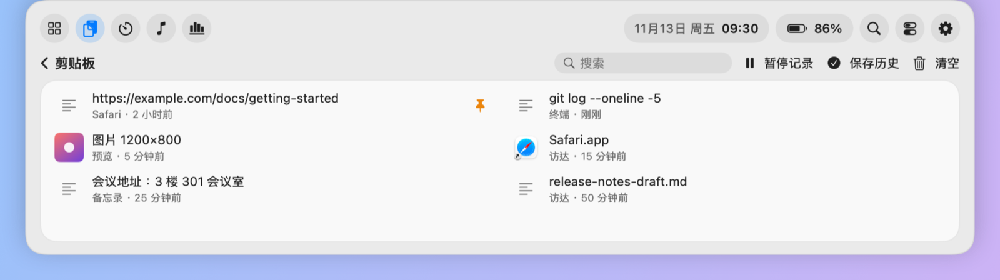 |
| **搜索** | **音乐** |
| 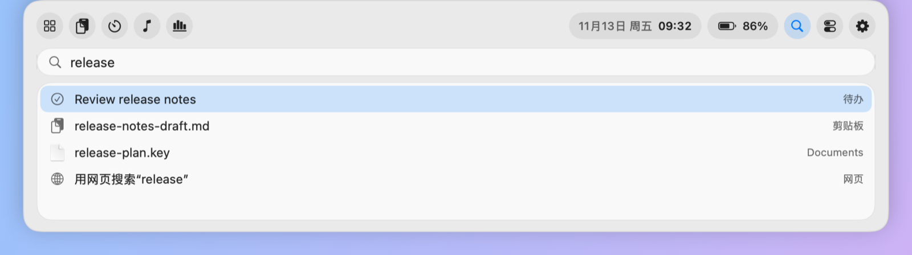 | 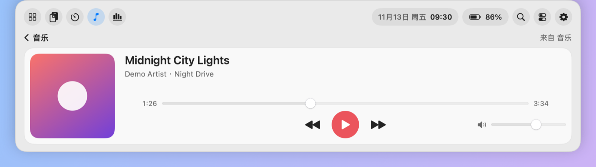 |
| **计时器** | **AI Token 用量** |
| 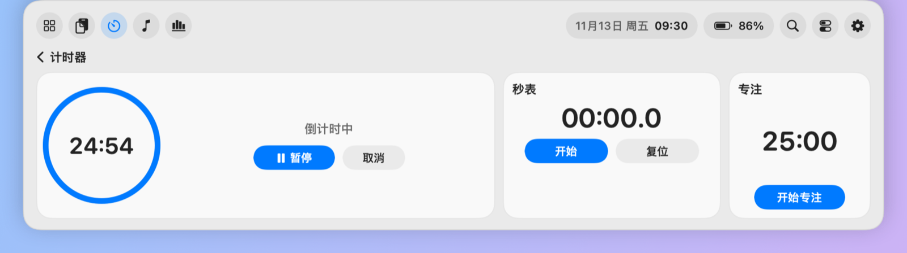 | 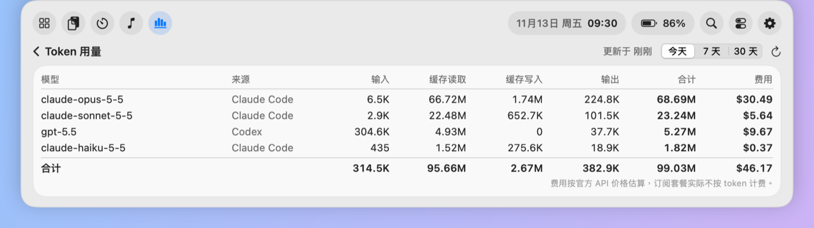 |

**剪贴板智能整理**：右键一条内容，只推荐适合它的整理方式。

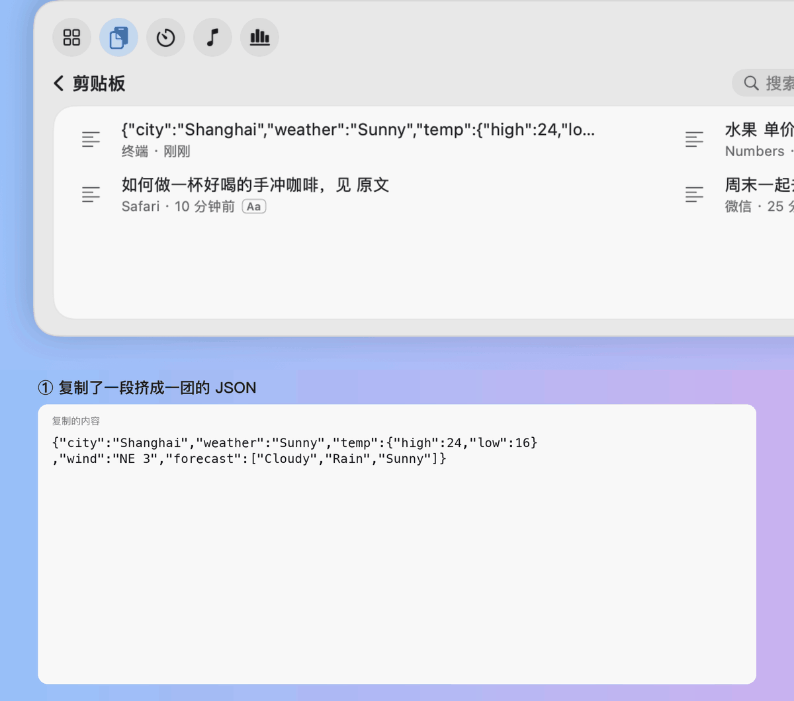

**装忙**：一键切到逼真的全屏工作画面。

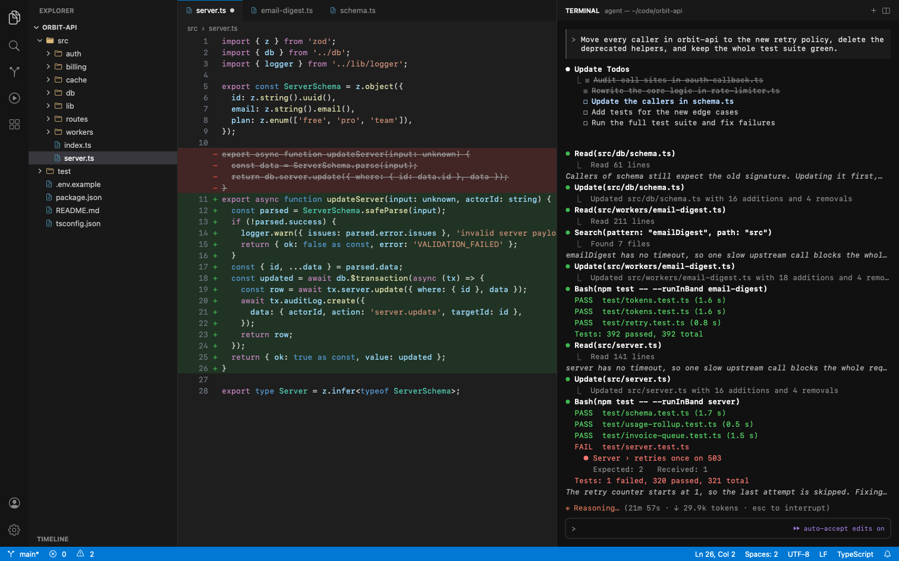

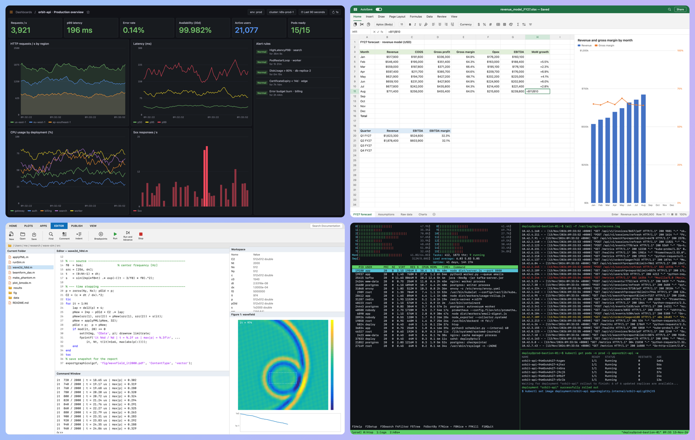

截图里都是虚构的演示数据。

## 功能

**首页**
- **卡片**：待办、短记、系统监控、音乐、日程、剪贴板、暂存架、今日用时，另有时钟、月历、计时器、Token 用量和装忙可选。可以排序、隐藏，分两页放。
- **日程**：本周日期和接下来 7 天的日程。Zoom、Teams、腾讯会议、飞书等会议链接可以一键加入。
- **暂存架**：把文件拖到面板上先放着，用时再拖出去或点开。
- **今日用时**：今天各个 App 在前台用了多久。

**菜单栏**
- 顶栏显示日期和时间；图标旁可以显示温度、CPU、网速、电量和更新提示。
- 右键图标：搜索、剪贴板、系统监控、音频输出、倒计时、防止休眠、装忙、息屏、锁屏和检查更新。

**剪贴板**
- 文字、图片和文件，可以搜索、置顶，重启后还在。密码管理器标记的内容不会记录。
- 保留粗体、链接和表格，点击时可以选择复制原格式、纯文本或去掉字体颜色的干净格式。
- 右键智能整理：格式化 JSON、把表格转成 Markdown、LaTeX 或 CSV、去掉链接跟踪参数、合并 PDF 断开的行等。
- 在本机识别图片里的文字，或抠出图里的主体。

**工具**
- **系统监控**：温度、功耗、内存、磁盘、网速、电池健康、占用最高的进程和最近 10 分钟的曲线。
- **快捷开关**：Wi-Fi、蓝牙、深色模式、夜览、防止休眠、静音、音量、亮度和蓝牙设备电量。
- **框选识字**和**取色**：框选屏幕上的文字直接复制，或用放大镜取 HEX 色值。
- **计时器**：倒计时、秒表和 25 分钟专注。
- **搜索**：应用、文件、待办、短记和剪贴板。
- **AI Token 用量**（可选）：按模型统计 Claude Code 和 Codex 的 token 和估算费用，只读取用量，不读对话内容。
- **提醒事项同步**（可选）：把“提醒事项”里的一个列表当作待办。

**装忙**：十个全屏工作场景，包括 AI 写代码、训练模型、写论文、监控大屏、编译和测试、MATLAB 仿真等，画面内容都是假的。接了多块屏幕时可以各选一个场景，竖屏会改成上下排。

**其他**：浅色或深色外观；简体中文、繁體中文、English、日本語、한국어、Français、Deutsch 和 Español；自动更新，在你不用 NotchDeck 时安装，可以关闭。

## 快捷键

| 快捷键 | 作用 |
| --- | --- |
| ⌥⌘N | 打开或收起面板 |
| ⌃⌥V | 打开或收起剪贴板页 |
| ⌃⌥B | 开始或退出装忙 |
| ⌃⌥T | 框选屏幕上的文字并复制 |
| ⌃⌥C | 取色并复制 HEX 色值 |
| Esc | 收起面板或退出装忙 |

## 安装

从 [Releases](https://github.com/wangwenxuan61/NotchDeck/releases) 下载最新的 `.dmg`，把 NotchDeck 拖到“应用程序”文件夹。需要 macOS 14 或更高版本和 Apple 芯片的 Mac。

NotchDeck 没有经过 Apple 公证，第一次打开会被拦截：先打开一次并关掉警告，再到“系统设置 → 隐私与安全性”，在 NotchDeck 旁边点“仍要打开”。之后的版本会自动更新。

## 权限

只有打开相关功能时才会申请：

- **日历**：日程卡片，只读取日程。
- **提醒事项**：提醒事项同步。打开时，本地未完成的待办会移到选中的列表。
- **蓝牙**：蓝牙开关和设备电量。
- **通知**：倒计时和专注结束的提醒，第一次开始计时时申请。
- **屏幕录制**：框选识字，第一次使用时申请。截图只在本机识别，用完就删。

从 0.1.11 起，授权在更新后会保留。

## 限制

- 温度、正在播放、深色模式、夜览、亮度、蓝牙开关和锁屏依赖 macOS 私有接口，系统更新后可能失效，也无法上架 Mac App Store。
- 亮度滑块只能调节内建屏。
- 目前只在一台运行 macOS 27、接一块屏幕的 Apple 芯片 Mac 上测试过。

## 开发

只需要 Xcode 命令行工具（`xcode-select --install`）：

```bash
git clone https://github.com/wangwenxuan61/NotchDeck.git
cd NotchDeck
./build.sh
open build/NotchDeck.app
```

提交前运行 `swift run NotchDeckChecks` 和 `python3 scripts/check-translations.py`，GitHub 每次推送也会自动运行。

发布版用固定的自签名证书签名，自动更新只接受同一个证书签的新版本。自己编译时，钥匙串里没有这个证书就用临时签名，每次重新编译后 macOS 可能会要求重新授权。

勿扰模式没有公开接口：在“快捷指令”里建两个叫 `NotchDeck 专注开始` 和 `NotchDeck 专注结束` 的指令，专注开始和结束时会自动运行。

## 许可证

[MIT](LICENSE)
